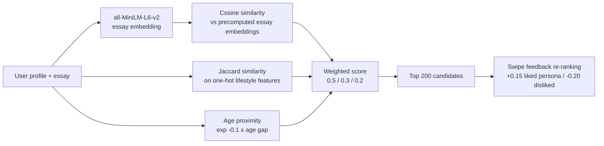

# PersonaMatch

A personality-aware recommendation demo. A user writes a short profile; the app ranks
~56,000 dating-profile records by a hybrid score that combines semantic similarity of
their free-text essays with lifestyle and age similarity, then re-ranks live from
like/dislike feedback. Built with Streamlit and Sentence-Transformers.

> **Demo only.** The records come from a public research dataset of real OkCupid profiles
> (see [Data and ethics](#data-and-ethics)). Do not use this to profile real people.

## How it works



| Component | Weight | Computed from |
| --- | ---: | --- |
| Personality | 50% | Cosine similarity of `all-MiniLM-L6-v2` embeddings of the essays |
| Lifestyle | 30% | Jaccard similarity over body type, diet, drinking, drugs, smoking, sign and religion seriousness |
| Demographics | 20% | `exp(-0.1 * |age difference|)` |

For straight users, candidates are first filtered to the opposite sex and compatible orientation; other users see all records. Each record also carries a coarse
"persona" label used by the feedback loop: a like adds 0.15 to every candidate with a liked
persona, a dislike subtracts 0.20.

The weights are hand-chosen, not tuned, and there is no offline evaluation of match quality.

## Run it

Requires Python 3.10+ and [Git LFS](https://git-lfs.com) (the precomputed embeddings,
87 MB, are stored with LFS).

```bash
git lfs install
git clone https://github.com/sachin2967/PersonaMatch.git
cd PersonaMatch
python -m venv .venv && source .venv/bin/activate   # Windows: .\.venv\Scripts\Activate.ps1
pip install -r requirements.txt
streamlit run app.py
```

The first run downloads the `all-MiniLM-L6-v2` model from Hugging Face.

## Repository layout

| Path | Contents |
| --- | --- |
| `app.py` | Streamlit app: scoring, re-ranking, UI |
| `data/okcupid_cleaned.csv` | 56,780 cleaned profile records (demographic and lifestyle columns, persona label; no essay text) |
| `data/okcupid_essay_embeddings_v2.npy` | Precomputed essay embeddings (Git LFS) |
| `images/` | 855 decorative placeholder avatars (see below) |

## Data and ethics

- **Profiles:** derived from the public OkCupid profile dataset released for research in
  2015, which was scraped without the users' consent and has been the subject of an ethics
  debate. This repo ships only cleaned categorical fields and embeddings, not the raw
  essays, names or usernames. Treat it accordingly and do not try to re-identify anyone.
- **Avatars:** the images in `images/` are generic 400x400 face images in Roboflow's export
  format. They are assigned to results by row index purely for visual effect and do **not**
  depict the people in the dataset. The upstream image dataset and its license are not
  recorded here; see `images/ATTRIBUTION.md` before reusing them.
- The persona labels (e.g. "The Eclectic Creative") are heuristic groupings, not validated
  psychological categories.

## Limitations

- The compatibility score is unvalidated: no ground-truth matches, no A/B test.
- The data is a 2012-era snapshot of one dating site's users and is demographically skewed.
- Feedback re-ranking works at the persona level, so it is crude.
- State lives in the Streamlit session; nothing is stored between visits.

## License

MIT for the code. The dataset and the images keep their original terms.
